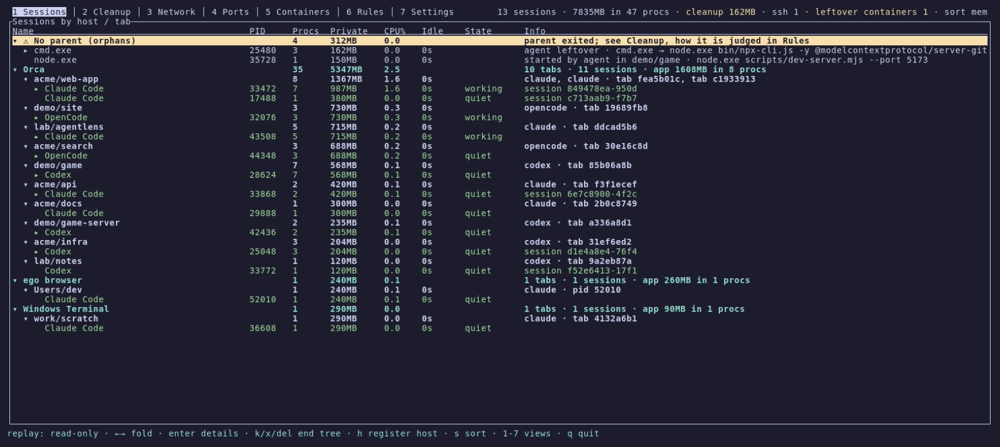
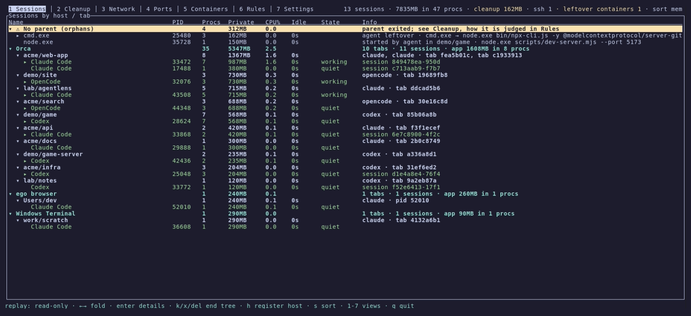
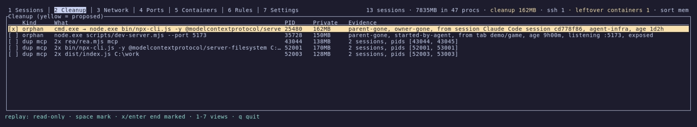
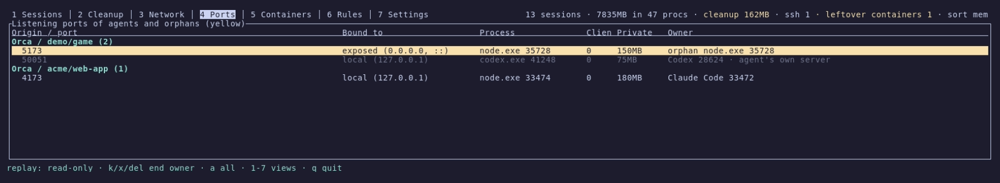
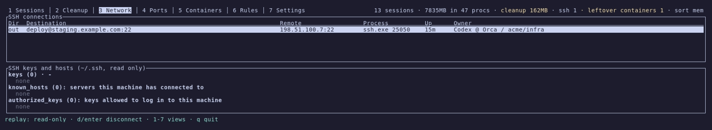
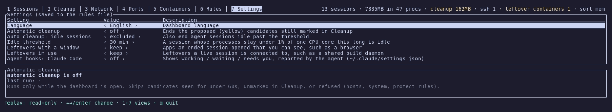
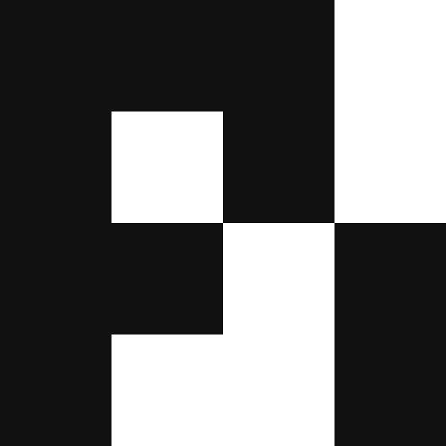

<h1 align="center">agentlens</h1>

<p align="center">
  <b>コーディングエージェントが起動したすべてのプロセスを見て、残されたものを安全に片付けます。</b>
</p>

<p align="center">
  <a href="LICENSE"></a>
  
  
</p>

<p align="center">
  <a href="README.md">English</a> · <a href="README.ko.md">한국어</a> · <b>日本語</b> · <a href="README.zh.md">简体中文</a>
</p>

<p align="center">
  
</p>

## なぜ agentlens なのか

コーディングエージェントは MCP サーバー、REPL、言語サーバー、開発サーバー、シェルなど多くのプロセスを起動します。
そして、

- **セッションが終わっても残ります。** ターミナルのタブを閉じたりエージェントがクラッシュしたりしても、MCP サーバーや
  開発サーバー、シェルは動き続けます。1 つで数百 MB を使うものもあり、1 日で積み上がります。
- **どれも同じに見えます。** タスクマネージャーや `htop` には `node.exe` が 17 個、`node_repl.exe` が 12 個並びます。
  今作業しているセッションのものはどれでしょうか。
- **推測で終了するのは危険です。** 違う `node` を終了すると、作業中のセッションが途中で止まります。

agentlens はすべてのプロセスについて **誰のものか、その持ち主はまだいるか** に答えます。プロセスを
*ホスト → タブ → エージェントセッション* でまとめ、終了したセッションが残したものを名前ではなく根拠で見つけ、
安全なときだけ終了します。

## 特長

- **誰のプロセスかが分かります。** [45 種類のエージェント](#対応エージェントとホスト)（Claude Code、Codex、opencode、
  Gemini CLI、Copilot CLI、Aider、Goose など）について、ホスト → タブ → セッション → プロセスのツリーを作ります。
  対応ホストは Orca、VS Code、Cursor、JetBrains、Windows Terminal、iTerm2、Ghostty、cmux、tmux、herdr、SSH ログイン、
  WSL などです。
- **名前ではなく根拠で残存プロセスを見つけます。** セッションの下で見たものを記録します（系譜）。エージェントが起動する
  すべてのものに書き込むセッションと PID を読みます（出生記録）。Windows では stdio サーバーにまだ誰かが話しかけられるかを
  確かめます。候補ごとに `owner-gone, from session Claude Code @ Orca / acme/web-app, agent-infra` のように根拠を示します。
- **安全を前提に設計しています。**
  - ホスト、システムプロセス、自分のターミナル、`protect` に指定したものは終了しません。
  - 親から先に終了し、終了する直前に各 PID の開始時刻を再確認します。
  - 確認は明示的な `y` でのみ受け付けます。
  - ウィンドウを持つアプリと、ほかの稼働中のセッションが使っているプロセスは、指定しない限り残します。
- **どのホストでも動きます。** 判定は OS の事実（プロセスツリー、開始時刻、環境変数、ソケット、パイプ）だけで行い、
  特定のホストアプリの内部情報には頼りません。
- **エージェントが自分の状態を伝えます。** 設定でエージェントフックを有効にすると、Claude Code が *入力待ち* と
  *要対応*（権限の確認）を知らせます。エージェントを待たせることはありません。
- **エージェントから問い合わせることもできます。** 設定から MCP サーバーを登録すると、エージェントが終了したセッションの
  残したものを一覧し、同じ安全ルールで終了できます。
- **軽量でネイティブです。** 待機中のメモリは約 9 MB、CPU は 1 コアの 1–3% です。Rust で書かれ、各 OS の
  カーネルインターフェースを直接呼び出します。
- **知識はデータとして持ちます。** エージェントとホストについての知識はすべて
  [`catalog.toml`](crates/core/catalog.toml) にあります。`rules.toml` で同じ形式のまま拡張できます。

## スクリーンショット

**Sessions**: 各エージェントが動かしているものを、ホストとタブごとにメモリ、CPU、状態とともに表示します。CPU% は
マシン全体を 100 として数え、フッターには現在のビューのキーが表示されます。



| Cleanup: 候補とその根拠 | Ports: 誰がどこで LISTEN しているか |
|---|---|
|  |  |
| **Network: SSH 接続と鍵** | **Settings: 片付け、安全、エージェントフック** |
|  |  |

スクリーンショットは架空のスナップショットを再生（`--replay`）したもので、実在のマシンは写っていません。UI の言語は
英語と韓国語です。

## 対応エージェントとホスト

次の 45 種類のエージェントをコマンド名で認識します。npm でインストールされ `node` で動くものも含みます。**太字**の
エージェントには、設定から agentlens の MCP サーバーを登録できます。エージェントフックは今のところ Claude Code のみです。

| エージェント | コマンド | エージェント | コマンド | エージェント | コマンド |
|---|---|---|---|---|---|
|  **Claude Code** | `claude` |  Claude Agent Teams | Orca が起動 |  **CodeBuddy** | `codebuddy` |
|  OpenClaude | `openclaude` |  **Codex** | `codex` |  Autohand | `autohand` |
|  Ante | `ante` |  Trae CLI | `traecli` |  **OpenCode** | `opencode` |
|  OpenCode 2 | `opencode2` |  MiMo Code | `mimo` |  Pi | `pi` |
|  OMP | `omp` |  Prime Agent | `prime-agent` |  **Qoder** | `qodercli` |
|  Qoder CN | `qoderclicn` |  **Gemini CLI** | `gemini` |  Antigravity CLI | `agy` |
|  Aider | `aider` |  Goose | `goose` |  **Amp** | `amp` |
|  **Kilo Code** | `kilo` |  **Kiro CLI** | `kiro-cli` |  Crush | `crush` |
|  **Auggie** | `auggie` |  Cline | `cline` |  Freebuff | `freebuff` |
|  Codebuff | `codebuff` |  Command Code | `command-code` |  Continue | `cn` |
|  **Cursor Agent** | `cursor-agent` |  **Droid** | `droid` |  **Kimi** | `kimi` |
|  Mistral Vibe | `vibe` |  **Qwen Code** | `qwen` |  **Rovo Dev** | `acli` |
|  Hermes | `hermes` |  OpenClaw | `openclaw` |  **GitHub Copilot CLI** | `copilot` |
|  Grok CLI | `grok` |  Muse | `muse` |  DSH | `dsh-tui` |
|  ZCode | `zcode` |  Devin | `devin` |  JCode | `jcode` |

アイコンは各プロジェクトのもので、多くは [Orca](https://github.com/stablyai/orca) から取得しました。

ホストはエージェントが動いているプログラムです。

| 種類 | ホスト |
|---|---|
| エージェントアプリとエディター | Orca、Claude Desktop、VS Code、Cursor、Windsurf（リモートサーバーと code-server を含む）、Kiro、Antigravity、Trae、Zed、JetBrains IDE |
| ターミナル | Windows Terminal、macOS Terminal、iTerm2、Ghostty、kitty、WezTerm、Alacritty、Warp、Wave、Tabby、cmux、GNOME Terminal、Konsole、Xfce Terminal、Tilix、Terminator、xterm |
| リモートとマルチプレクサー | SSH ログイン、WSL、tmux、herdr、screen |
| その他 | ego browser |

タブごとに変数を設定するホストは、その値でタブを分けます。Orca（`ORCA_TAB_ID`、worktree ごとに 1 行）、
Windows Terminal（`WT_SESSION`）、cmux（`CMUX_WORKSPACE_ID`、workspace ごとに 1 タブ）です。SSH ログイン 1 つ、
tmux・herdr・screen のペイン 1 つがそれぞれ 1 タブになります。ここにないプログラムがエージェントを起動すると
「(unregistered)」として表示され、Sessions で `h` を押すとルールに追加できます。

## インストール

[最新リリース](https://github.com/IceMan0224/agentlens/releases/latest)からお使いのプラットフォーム用のアーカイブ
（Windows x64、Linux x64、macOS は Apple シリコンのみ）をダウンロードして展開し、`agentlens` を実行します。macOS では、
ダウンロードしたバイナリの初回実行時に `xattr -d com.apple.quarantine agentlens` が必要な場合があります。

自分でビルドする場合は [Rust](https://rustup.rs) 1.88 以降が必要です。

```sh
cargo install --git https://github.com/IceMan0224/agentlens agentlens
```

またはソースからビルドします。

```sh
git clone https://github.com/IceMan0224/agentlens
cd agentlens
cargo build --release
./target/release/agentlens
```

## 使い方

```sh
agentlens                          # 対話型ダッシュボード
agentlens --report                 # 現在の状態を一度だけ出力
agentlens --dump-json > snap.json  # 生のスナップショット（コマンドラインの秘密情報は伏せ字）
agentlens --report snap.json       # 保存したスナップショットを分類
agentlens --replay snap.json       # 保存したスナップショットをダッシュボードで読み取り専用で表示
agentlens locks <path>             # ファイルやフォルダーを掴んでいるプロセスをエージェントセッションごとに表示
```

更新や削除が `EBUSY`、「resource busy or locked」、「別のプロセスが使用中」で失敗したとき、`agentlens locks` は
そのパス内の実行ファイルを動かしているプロセス、そこを作業フォルダーにしているプロセス、（Windows）その中の何かを
開いているプロセスを一覧します。エージェントセッションごとにまとめ、残存プロセスには根拠を付けます。

```text
3 process(es) hold C:\Users\me\AppData\Roaming\npm\node_modules\@openai\codex:
- Codex @ Orca / acme/web-app (pid 28624)
  - pid 12040 codex.exe: runs node_modules\@openai\codex-win32-x64\...\bin\codex.exe
  - pid 39448 codex-code-mode-host.exe: runs node_modules\@openai\...\bin\codex-code-mode-host.exe
- leftover node.exe watcher.js (pid 25480): proposed, owner-gone, from session Codex @ Orca / acme/api
  - pid 25480 node.exe: has node_modules\@openai\codex\package.json open
```

| ビュー | 表示内容 | キー |
|---|---|---|
| 1 Sessions | ホスト › タブ › セッション › プロセスツリーとメモリ、CPU、アイドル時間、状態 | `←/→` 折りたたみ、`enter` 詳細、`k` 選択したツリーを終了、`h` ホストを登録 |
| 2 Cleanup | 片付けの候補とそれぞれの根拠（黄色 = 提案） | `space` マーク、`x` マークしたものを終了 |
| 3 Network | SSH 接続、鍵、known hosts | `d` 切断 |
| 4 Ports | セッションと残存プロセスの LISTEN ポート | `k` 持ち主を終了、`a` すべてのポート |
| 5 Rules | 残存プロセスの見つけ方、この PC にあるエージェントとホスト（`PATH` 上のコマンド、アプリランチャー: スタートメニュー、`.desktop`、`.app`、実行中のもの）と残りのカタログ、ルールファイル | `e` 編集、`r` 再読み込み |
| 6 Settings | 言語、自動片付け、アイドルのしきい値、残すもの、エージェントフック、エージェント MCP | `←/→`/`enter` 変更 |

共通キー: `1`–`6` または `tab` でビュー切り替え、`s` 並べ替え（メモリ、CPU、アイドル）、マウスホイールとクリック、
`q` 終了。

## 仕組み

agentlens は毎秒、各 OS 固有のインターフェース（Windows は `NtQuerySystemInformation`、macOS は `sysctl`/libproc、
Linux は `/proc`）ですべてのプロセスを一覧し、ツリーを作ります。エージェント、ホスト、シェル、ランタイムはカタログで
認識します。エージェントの祖先を持たないエージェントプロセスがそれぞれセッションの根になります。その上にある最も近い
ホストと、ホストのタブ変数でタブが決まります。同じ worktree の Orca のタブは 1 行にまとまります。

次のどちらかに当てはまるプロセスを残存プロセスとみなします。

- **親がいない。** 親 PID が再利用された場合や、Unix で launchd や systemd に引き取られた場合も含みます。
- **起動したセッションが終了している。** 次の 3 つの方法で見つけます。
  - *系譜*: ダッシュボードがそのプロセスをそのセッションの下で見ていた。
  - *出生記録*: プロセスが `AI_AGENT`、`CLAUDE_CODE_SESSION_ID`、`CLAUDE_PID` を持っている。エージェントが設定し、
    子が継承します。
  - *チャネル切断*（Windows のみ）: プロセスの入力パイプに書き込める相手がもういない。

残存プロセスは、持ち主がいなくなったのを確認してから 15 秒後に片付けの候補として提案されます。詳しいルールは Rules
ビューと[韓国語ドキュメント](README.ko.md)にあります。

`nohup uv run python run.py` のように稼働中のセッションのツリーから離れたプロセスは、残存プロセスではありません。
そのセッションの下に *detached* として残り、セッションを終了すると一緒に終了します。

### エージェントフック

設定で **Agent hooks** を有効にすると、エージェント自身のフック設定（Claude Code: `~/.claude/settings.json`）に
agentlens を追加します。ほかのフックや設定はそのまま残し、先にファイルをバックアップします。以後エージェントは
セッション開始、プロンプト、停止、通知、セッション終了のときに agentlens をバックグラウンドで実行するので、自分で
何かを実行する必要はありません。Codex と Gemini CLI は、フックの形式とバックグラウンド実行を確認したうえで対応する予定です。

### エージェント MCP

設定でエージェントごとに **Agent MCP** を有効にすると、エージェントに「残存プロセスはある？」「片付けて」と頼めます。
設定には、このマシンで使われている MCP 対応のエージェント（Claude Code、Codex、Gemini CLI、Qwen Code、opencode、Cursor、
Copilot CLI、Kiro、Droid、Amp、Kimi、CodeBuddy、Qoder、Auggie、Kilo Code、Rovo Dev）が並びます。agentlens はエージェントの
ユーザー単位の MCP 設定に `agentlens mcp` を追加します。同じバイナリなので、ほかにインストールするものはありません。
ほかの設定はそのまま残し、先にファイルをバックアップします。ファイルを頻繁に書き換える Claude Code は、Claude Code 自身の
`claude mcp add` で変更します。

| ツール | 機能 |
|---|---|
| `list_leftovers` | 片付けの候補、それぞれの根拠、提案されているかどうか |
| `list_session_processes` | 問い合わせたセッションのプロセスツリーとメモリ、コマンド、LISTEN ポート |
| `end_leftovers` | 提案された候補、または pid で指定した候補を終了。候補一覧の外のものと、問い合わせたセッション自身は終了しません |
| `find_lock_holders` | ファイルやフォルダーを掴んでいるプロセス（`agentlens locks` と同じ結果）。更新や削除に失敗したエージェントが、どのセッションを閉じればよいか分かります |

MCP サーバーは質問を中継するだけです。判定と終了は、セッションを見てきたダッシュボードが、自分で終了するときと同じ拒否
ルールと再確認で行います。そのためダッシュボードを起動しておく必要があり、起動していなければツールがそう答えます。両者は
agentlens の状態フォルダー（`%LOCALAPPDATA%\agentlens\requests`、`~/.local/state/agentlens/requests`）の小さなファイルで
やり取りするので、ポートは開きません。ツールを許可していなければ、エージェントは終了する前にあなたに確認します。

## 設定

ルールは Windows では `%APPDATA%\agentlens\rules.toml`、それ以外では `$XDG_CONFIG_HOME/agentlens/rules.toml`
（既定は `~/.config/agentlens/rules.toml`）にあります。カタログと同じテーブルを使い、カタログを拡張します。

```toml
idle_minutes = 30
protect = ["dev-server"]          # 名前やコマンドラインにこれを含むプロセスは終了しない
language = "en"                   # en | ko
auto_cleanup_minutes = 0          # 0 = オフ
end_windowed = false              # ウィンドウを持つ残存プロセスも提案する
end_shared = false                # 稼働中のセッションが使う残存プロセスも提案する

[[agents]]                        # カタログにないエージェント
id = "myagent"
exe = ["myagent"]

[[hosts]]                         # カタログにないターミナルや IDE
id = "myterm"
exe = ["myterm"]
tab_env = "MYTERM_TAB"
```

## 制限事項

- SSH の切断は、その接続を持つプロセスを終了する方式です。TCP 接続だけを切ることはしません。
- ほかのユーザーやサービスのプロセスは読めないため、分類しません。
- 開いているファイルを調べるのは Windows だけです（開いているファイルが置き換えや削除を妨げるのは Windows です）。
  ほかの OS では `locks` は実行中の実行ファイルと作業フォルダーを報告します。Windows では開けるプロセスのファイル
  ハンドルをすべて読み（約 0.5 秒）、ほかのユーザーのプロセスは見えません。
- チャネル切断の確認は今のところ Windows のみです。macOS と Linux では、Node が起動した MCP サーバーはパイプではなく
  ソケットペアで通信するためです。

## 開発

```sh
cargo test --workspace
cargo clippy --workspace --all-targets
```

テストには、実際に近い架空のスナップショット、macOS/Linux 形式のプロセスツリー、時間の経過に伴う残存プロセスの検出、
各 OS で実際のプロセスを起動・検出・終了するライブテストが含まれます。

スクリーンショットとアニメーションは、[`docs/demo`](docs/demo) のテープから [VHS](https://github.com/charmbracelet/vhs)
で、架空のスナップショットを再生して録画しています。先に `cargo build --release` を実行してから
`vhs docs/demo/demo.tape` を実行します。

コントリビューションを歓迎します。新しいエージェントやホストは、たいてい [`catalog.toml`](crates/core/catalog.toml) に
項目を 1 つ足すだけです。大きな変更は先に issue を立ててください。

## ライセンス

[MIT](LICENSE)
