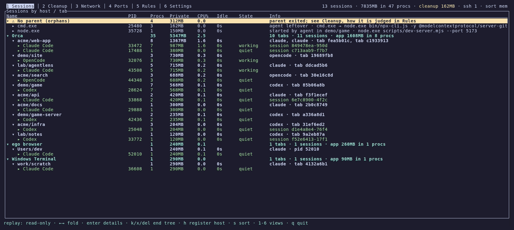
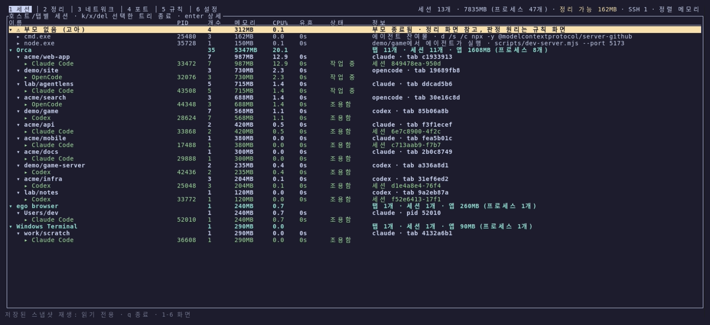
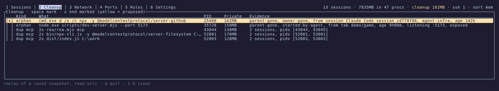
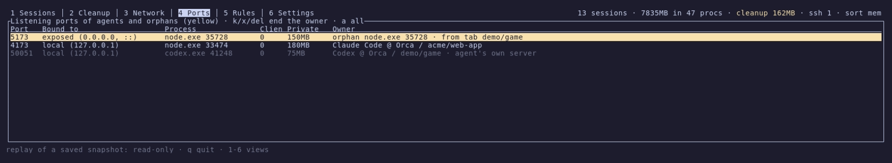
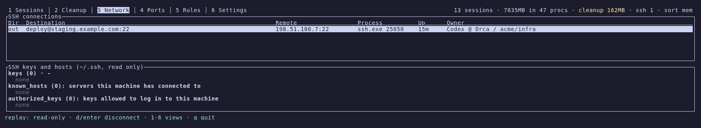
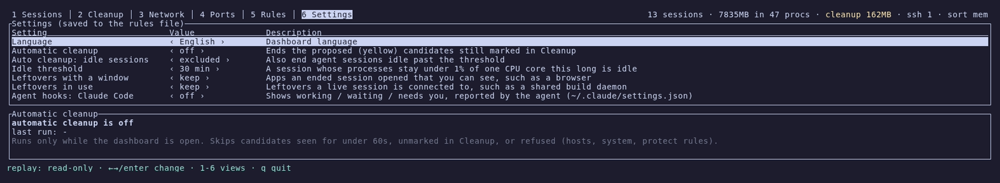

<h1 align="center">agentlens</h1>

<p align="center">
  <b>코딩 에이전트가 띄운 모든 프로세스를 보고, 남겨진 것을 안전하게 정리합니다.</b>
</p>

<p align="center"><a href="README.md">English</a> | <b>한국어</b></p>

<p align="center">
  
</p>

## 왜 agentlens인가

코딩 에이전트는 MCP 서버, REPL, 언어 서버, dev 서버, 셸 같은 프로세스를 많이 띄웁니다. 그런데

- **세션이 끝나도 남습니다.** 터미널 탭을 닫거나 에이전트가 죽어도 MCP 서버와 dev 서버, 셸은 계속 돕니다.
  하나에 수백 MB씩 쓰는 것도 있고, 하루면 쌓입니다.
- **다 똑같아 보입니다.** 작업 관리자나 `htop`에는 `node.exe` 17개, `node_repl.exe` 12개가 뒤섞여 있습니다.
  어느 것이 지금 쓰는 세션 것인지 알 수 없습니다.
- **추측으로 끄면 위험합니다.** 엉뚱한 `node`를 끄면 작업 중인 세션이 죽습니다.

agentlens는 모든 프로세스에 대해 **누구의 것인가, 그 주인이 아직 살아 있는가**를 답합니다.
프로세스를 *호스트 → 탭 → 에이전트 세션*으로 묶고, 끝난 세션이 남긴 것을 이름이 아니라 근거로 찾아,
안전할 때만 정리합니다.

## 특장점

- **누구의 프로세스인지 압니다.** 에이전트 45종(Claude Code, Codex, opencode, Gemini CLI, Copilot CLI, Aider,
  Goose …)에 대해 호스트 → 탭 → 세션 → 프로세스 트리를 만듭니다. 지원 호스트는 Orca, VS Code, Cursor,
  JetBrains, Windows Terminal, iTerm2, Ghostty, tmux, SSH 로그인, WSL 등입니다.
- **이름이 아니라 근거로 잔여 프로세스를 찾습니다.** 세 가지 근거를 씁니다.
  - 계보: 세션 아래에서 본 프로세스를 기억합니다.
  - 출생 기록: 에이전트가 자식에 남기는 세션과 PID를 읽습니다.
  - 통신 채널 끊김(Windows): stdio 서버에 아직 말을 걸 수 있는지 확인합니다.

  후보마다 `owner-gone, from session Claude Code @ Orca / acme/web-app, agent-infra`처럼 근거를 보여 줍니다.
- **안전이 기본입니다.**
  - 호스트, 시스템 프로세스, 자기 터미널, `protect` 규칙에 걸린 것은 끝내지 않습니다.
  - 부모부터 끝내고, 끝내기 직전에 PID와 시작 시각을 다시 확인합니다.
  - 확인은 `y`로만 받습니다.
  - 창이 있는 앱과 다른 세션이 쓰는 프로세스는 설정하지 않는 한 남겨 둡니다.
- **어떤 호스트에서든 동작합니다.** 판정은 OS의 사실(프로세스 트리, 시작 시각, 환경변수, 소켓, 파이프)로만
  하고, 특정 호스트 앱의 내부 정보에 기대지 않습니다.
- **에이전트가 직접 물어볼 수 있습니다.** 설정에서 MCP 서버를 등록하면 에이전트가 끝난 세션이 남긴 것을
  조회하고, 같은 안전 규칙으로 정리할 수 있습니다.
- **에이전트가 직접 상태를 알려 줍니다.** 설정에서 에이전트 훅을 켜면 Claude Code가 *입력 대기*,
  *확인 필요*(권한 요청 등)를 알려 줍니다. 에이전트를 기다리게 하지 않습니다.
- **가볍고 네이티브입니다.** 대기 중 메모리 약 9MB, 한 코어의 1~3%를 씁니다. Rust로 작성했고 OS마다
  커널 인터페이스를 직접 씁니다.
- **지식은 데이터로 둡니다.** 에이전트와 호스트에 대한 지식은 [`catalog.toml`](crates/core/catalog.toml)에 있고,
  `rules.toml`로 같은 형식으로 확장합니다.

## 스크린샷



| 정리: 후보와 판정 근거 | 포트: 누가 어디서 대기 중인지 |
|---|---|
|  |  |
| **네트워크: SSH 연결과 키** | **설정: 정리, 안전, 에이전트 훅** |
|  |  |

화면은 지어낸 스냅샷을 재생(`--replay`)해 찍었으므로 실제 PC의 정보는 없습니다.

## 설치와 실행

[최신 릴리스](https://github.com/IceMan0224/agentlens/releases/latest)에서 플랫폼에 맞는 압축 파일(Windows x64,
Linux x64, macOS Apple silicon·Intel)을 받아 풀고 `agentlens`를 실행합니다. macOS에서 내려받은 바이너리를 처음
실행할 때는 `xattr -d com.apple.quarantine agentlens`가 필요할 수 있습니다.

직접 빌드하려면 [Rust](https://rustup.rs) 1.88 이상이 필요합니다.

```powershell
cargo build --release
.\target\release\agentlens.exe            # 대시보드 (macOS/Linux: ./target/release/agentlens)
.\target\release\agentlens.exe --report   # 현재 상태를 텍스트로 한 번 출력
.\target\release\agentlens.exe --dump-json > snap.json   # 원시 스냅샷 (디버깅/테스트용)
.\target\release\agentlens.exe --report snap.json        # 저장한 스냅샷으로 분류 결과 보기
.\target\release\agentlens.exe --replay snap.json        # 저장한 스냅샷을 대시보드에서 읽기 전용으로 보기
```

`--replay`는 스냅샷의 PID가 이 PC의 다른 프로세스일 수 있으므로 아무것도 끝내지 않습니다(확인해도 읽기 전용 안내).
자동 정리, 훅 등록, 규칙 편집도 하지 않고, 이 PC의 SSH 키나 훅 상태도 읽지 않습니다. 설정 변경은 그 실행에만 적용됩니다.

## 화면과 키

| 뷰 | 내용 | 주요 키 |
|---|---|---|
| 1 Sessions | 호스트 › 탭(worktree) › 에이전트 세션 › 프로세스 트리, Private 메모리·CPU·유휴 시간, 세션 상태(최근 10초 안에 CPU 1% 이상이면 작업 중, 유휴 기준을 넘기면 유휴, 그 외 조용함) | `←/→`·`space` 접기/펼치기, `enter` 상세(명령줄·cwd·연결), `k`/`x`/`Del` 선택한 호스트 그룹·탭·세션·프로세스 트리 종료(호스트 그룹·탭은 그 안의 에이전트 세션만), `h` 미등록 호스트 등록 |
| 2 Cleanup | 정리 후보와 판정 근거 (노란색 = 기본 제안) | `space` 표시, `x` 표시한 항목 종료 |
| 3 Network | SSH 연결: 목적지(별칭 해석), 원격 주소, 프로세스, 소유 세션. 아래에 `~/.ssh`의 키(종류·SHA256 지문·주석·개인키 유무·`config`에서 쓰는 호스트), `known_hosts`, `authorized_keys`를 조회 전용으로 표시(개인키 내용은 읽지 않음, 화면을 열 때마다 다시 읽음) | `d` 연결 끊기 (나가는 연결은 ssh 클라이언트, 들어오는 연결은 그 로그인의 `sshd-session` 종료) |
| 4 Ports | 에이전트 세션과 고아가 연 LISTEN 포트: 바인딩(외부 노출/로컬), 프로세스, 다른 프로세스의 접속 수, 메모리, 주인(세션 또는 고아와 출처 탭). 에이전트 자체 서버는 흐리게, 고아는 노란색 | `k`/`x`/`Del` 주인 종료(고아는 고아 트리 전체, 세션 소속이면 그 프로세스와 하위만, 세션은 유지), `a` 모든 포트 보기 |
| 5 Rules | 고아 판정 원리, 카탈로그·설치 스캔 결과·규칙 파일 | `↑↓` 스크롤, `e` 편집기로 열기(메모장 / `open -t` / `xdg-open`), `r` 다시 읽기 |
| 6 Settings | 언어(English/한국어), 자동 정리 주기·유휴 세션 포함 여부, 유휴 기준, 창이 있거나 사용 중인 잔여 프로세스 처리, 에이전트 훅·에이전트 MCP 켜기/끄기 | `←/→`·`enter`·클릭 변경. 바꾸는 즉시 적용되고 규칙 파일의 해당 줄만 고쳐 저장(주석 유지) |

공통: `1-6`/`tab` 뷰 전환, `s` 정렬(메모리→CPU→유휴), 마우스 휠·클릭(같은 행 두 번 클릭 = 접기), `q` 종료.

메모리는 그 프로세스만 쓰는 양 기준입니다: Windows는 Private Bytes(commit), macOS는 활동 모니터와 같은
phys_footprint, Linux는 상주 페이지에서 공유 페이지를 뺀 값(`statm`). Working Set/RSS는 공유 메모리가
중복으로 들어가 합계가 부풀려지므로 상세 패널에만 함께 표시합니다.

## 어떻게 판정하나

판정에 쓰는 지식(셸·런타임·시스템 프로세스 이름, 에이전트 45개, 호스트, 모델 제공자, SSH 클라이언트·서버·포트,
세션 ID 플래그 등)은 코드가 아니라 [`crates/core/catalog.toml`](crates/core/catalog.toml)에 데이터로 있습니다.
빌드할 때 실행 파일에 포함되고, 사용자 규칙 파일이 같은 형식으로 확장합니다.

- **에이전트**: Orca가 지원하는 45개 에이전트의 명령 이름을 카탈로그로 내장했습니다.
  시작할 때 PATH를 한 번 스캔해서 npm 실행 파일의 실제 대상(Windows `zcode.cmd`, macOS/Linux의
  `node_modules`로 가는 심볼릭 링크나 스크립트)을 알아내므로, `node`로 떠 있는 에이전트도 잡힙니다.
  실행 파일 이름과 argv[0] 둘 다 보므로 버전 이름으로 설치되는 실행 파일(`claude/versions/2.1.276`)도 잡힙니다.
- **호스트/탭**: Orca, VS Code·Cursor·Windsurf(원격 서버·code-server 포함), Kiro, Antigravity, Trae, Zed, JetBrains,
  Claude Desktop, Windows Terminal, macOS Terminal, iTerm2, Ghostty, kitty, WezTerm, Alacritty, Warp,
  Wave, Tabby, GNOME Terminal/Konsole 등, ego. SSH 로그인(`sshd`/`sshd-session`)과 tmux·screen도 호스트로
  보고 로그인·패널 하나를 탭 하나로 묶습니다. 탭을 표시하는 환경변수를 넣어 주는 호스트는 그 값으로 묶습니다
  (카탈로그의 `tab_env`/`label_env`: Orca는 `ORCA_TAB_ID`와 worktree 이름, Windows Terminal은 `WT_SESSION`).
  카탈로그에 없는 프로그램이 에이전트를 띄우면 "(unregistered)" 그룹으로 자동으로 묶이고, `h`로 등록할 수 있습니다.
  등록은 규칙 파일 끝에 항목을 덧붙이는 방식이라 주석과 아직 다시 읽지 않은 편집 내용이 유지됩니다.
- **모델 제공자**: `ANTHROPIC_BASE_URL`/`OPENAI_BASE_URL`이나 명령줄로 GLM(Z.ai), Kimi, DeepSeek 등을 표시합니다.
- **고아**: 부모가 없거나, 부모 PID가 더 늦게 시작된 다른 프로세스로 재사용된 경우. macOS/Linux에서는
  부모가 죽으면 launchd/init/`systemd --user`에 입양되므로 이 경우를 `adopted-by-init`으로 판정합니다.
  모든 GUI 앱도 launchd/systemd의 자식이므로, 입양된 프로세스는 그 자체가 에이전트 구성요소(또는 그것을 돌리는
  셸)일 때만 에이전트 관련으로 봅니다. 아래에 MCP 서버를 띄운 앱이라는 이유만으로는 고아가 아닙니다.
  WSL의 세션별 `/init` 중계 프로세스처럼 PID 1이 아닌 `init`은 입양자가 아닙니다.
  - **끝난 세션이 남긴 것**도 고아입니다. 두 가지로 알아냅니다. 호스트와 상관없이 OS의 사실만 씁니다.
    - 계보: 대시보드가 그 프로세스를 세션 아래에서 본 적이 있으면, 세션이 끝난 뒤 남은 것을 압니다(모든 에이전트).
    - 출생 기록: 에이전트는 자기가 띄우는 프로세스에 환경변수를 넣고, 이 값은 자손에게 상속되며 부모가 죽어도
      남습니다. Claude Code는 `AI_AGENT`(`…_harness`: MCP 서버 등 직접 띄운 것, `…_agent`: 모델이 실행한 명령),
      `CLAUDE_CODE_SESSION_ID`, `CLAUDE_PID`를 넣습니다. 그래서 대시보드를 켜기 전에 남은 것도 찾습니다.
      변수 이름은 카탈로그(`agent_env`, 에이전트별 `ai_agent`·`session_env`·`pid_env`)에 있습니다.
    - 통신 채널 끊김(Windows): MCP 서버·언어 서버·REPL처럼 표준 입력 파이프로 요청을 받는 프로세스는, 그 파이프에
      쓰는 쪽이 모두 닫히면 다시는 요청을 받을 수 없습니다. 부모가 사라진 프로세스만 확인하며(`stdio-closed`),
      런타임·셸이면 제안하고 그 밖의 프로그램은 보여 주기만 합니다. 살아 있는 서버는 입력을 기다리는 동안 확인이
      멈추므로 확인마다 작은 스레드를 쓰고, 파이프가 닫히는 순간 그 확인이 끝나며 알려 줍니다. macOS·Linux는 아직
      지원하지 않습니다.
    - 주인이 사라진 것을 본 뒤 15초가 지나야 고아로 봅니다(정상 종료 중인 자식, `docker run` 서버의 정지 시간).
      살아 있는 세션에서 일부러 떼어 낸 프로세스(`nohup … &`)나, 끝난 세션 안에서 시작돼 아직 살아 있는 다른
      에이전트 세션은 고아가 아닙니다.
  - **기본 제안**: 에이전트 구성요소(에이전트, REPL, MCP 서버, 에이전트 런타임)가 남은 고아와, dev 서버를 포함해
    끝난 세션이 남긴 모든 것. 다만 창이 있는 것(에이전트가 연 브라우저 등)과 살아 있는 세션이 연결해 쓰는 것(공용
    빌드 데몬 등)은 설정의 `end_windowed`·`end_shared`를 켜지 않는 한 남겨 둡니다(`has-window`, `in-use by …`).
  - 출처를 모르는 dev 서버 같은 프로그램은 "started-by-agent, from tab …"으로 보여만 줍니다.
  - 고아 트리가 연 포트도 근거로 붙습니다(`listening :3050`, 0.0.0.0처럼 외부에 열려 있으면 `exposed`).
    49152 이상 동적 포트는 프로그램 내부 통신용인 경우가 많아 다른 포트가 없을 때만 적습니다.
- **에이전트 훅**: 설정 화면에서 켜면 agentlens가 에이전트 자신의 훅 설정(Claude Code: `~/.claude/settings.json`)에
  항목을 추가합니다. 다른 도구가 넣은 훅과 나머지 설정은 그대로 두고, 쓰기 전 파일을 `settings.json.agentlens-bak`으로
  백업합니다. 그 뒤 에이전트가 세션 시작·프롬프트 제출·응답 종료·알림·세션 종료 때 agentlens를 백그라운드로(`async`)
  실행해 상태를 알려 주므로, Sessions의 상태가 작업 중 / 입력 대기 / 확인 필요(권한 요청 등)로 정확해집니다. 사용자가
  직접 실행할 명령은 없습니다. 상태 파일은 `%LOCALAPPDATA%\agentlens\sessions`(macOS·Linux는 `~/.local/state/agentlens/sessions`)에
  세션마다 하나씩 남고, 세션이 끝나면 지워집니다. 지금은 Claude Code만 지원합니다(Codex·Gemini는 훅 형식과 비동기 실행
  지원을 확인한 뒤 카탈로그 데이터로 추가).
- **에이전트 MCP**: 설정 화면에서 에이전트별로 켜면 에이전트에게 "고아 프로세스 있어?", "정리해"라고 시킬 수 있습니다.
  이 PC에 설치됐거나 설정 파일이 있고 MCP를 지원하는 에이전트만 보입니다(Claude Code, Codex, Gemini CLI, Qwen Code,
  opencode, Cursor, Copilot CLI, Kiro, Droid, Amp, Kimi, CodeBuddy, Qoder, Auggie, Kilo Code, Rovo Dev). 켜면 에이전트의
  사용자 범위 MCP 설정에 같은 실행 파일의 `agentlens mcp`를 추가하므로 따로 설치할 것은 없습니다. 다른 설정은 그대로 두고
  먼저 백업하며, 설정 파일을 수시로 다시 쓰는 Claude Code는 자체 명령(`claude mcp add`)으로 등록합니다. 실행 파일을 옮기면
  "경로 바뀜"으로 표시되고, 다시 누르면 고쳐집니다.

  | 도구 | 하는 일 |
  |---|---|
  | `list_leftovers` | 정리 후보와 근거, 기본 제안 여부 |
  | `list_session_processes` | 물어본 세션의 프로세스 트리(메모리, 명령줄, LISTEN 포트) |
  | `end_leftovers` | 기본 제안된 후보, 또는 pid로 지정한 후보를 종료. 후보 목록 밖의 프로세스와 물어본 세션 자신은 끝내지 않음 |

  MCP 서버는 질문을 전달만 하고, 판정과 종료는 세션을 지켜본 대시보드가 직접 정리할 때와 같은 거부 규칙과 재확인으로
  합니다. 그래서 대시보드가 켜져 있어야 하고, 꺼져 있으면 도구가 그렇게 답합니다. 둘은 상태 폴더의 작은 파일
  (`%LOCALAPPDATA%\agentlens\requests`, macOS·Linux는 `~/.local/state/agentlens/requests`)로 주고받으므로 포트를 열지 않습니다.
  도구 사용을 허용해 두지 않았다면 에이전트가 종료 전에 먼저 물어봅니다.
- **수집**: OS마다 커널 인터페이스를 직접 씁니다(`crates/core/src/sys/`).

  | OS | 매초 (전체 프로세스) | 새 프로세스마다 한 번 |
  |---|---|---|
  | Windows | `NtQuerySystemInformation` 한 번 | `QueryFullProcessImageNameW`, `NtQueryInformationProcess`(명령줄). cwd·환경변수는 PEB에 있어 sysinfo로 5초마다 일괄 |
  | macOS | `sysctl(KERN_PROC_ALL)` 한 번(모든 사용자) + 프로세스별 `proc_pid_rusage` | `proc_pidpath`, `sysctl(KERN_PROCARGS2)`(인자·환경), vnode 경로(cwd) |
  | Linux | `/proc/<pid>/stat`, `statm` | `/proc/<pid>/exe`, `cmdline`, `cwd`, `environ` |

  TCP 연결과 LISTEN 포트 목록은 한 번에 함께 읽어 3초마다 갱신합니다(종료·연결 끊기 직후에는 즉시). 환경변수는 탭·제공자 판정에 필요한 키만
  남기고 나머지(비밀값 포함)는 바로 버립니다. 명령줄은 비밀처럼 보이는 플래그의 값(`--api-key x`, `--token=x`,
  `-pw x`), `NAME_TOKEN=x` 형태의 대입, URL의 비밀번호(`https://user:pw@host`)를 `***`로 가린 뒤 보관하므로
  `--dump-json`에도 남지 않습니다. 이름과 형태로 찾는 방식이라 모든 형식을 잡지는 못합니다(예: `mysql -ppw`).
- **SSH 연결**: ssh 클라이언트·서버의 연결과, 어떤 프로세스든 카탈로그의 SSH 포트(22)로 가는 연결을 보여 줍니다.
  `~/.ssh/config`의 `Port`는 sshd가 받는 연결에만 적용합니다(`Port 443` 설정이 모든 HTTPS를 SSH로 만들지 않도록).
  plink/putty는 PuTTY 옵션 문법(`-pw`, `-load`)으로 해석합니다.
- **유휴 세션**: 세션 트리 전체가 `idle_minutes`(기본 30분) 동안 CPU 1% 미만. 모니터링을 시작한
  시점부터 세므로 막 실행했을 때는 실제보다 짧게 보입니다.
- **중복 MCP**: 같은 명령의 MCP 서버가 여러 세션에 떠 있으면 알려 줍니다(정보용).
- **자동 정리**: 설정한 주기(5~60분)마다 정리 화면에서 표시된 기본 제안 후보를 종료합니다. 대시보드가 열려 있는
  동안만 동작하고, 켠 시점부터 주기를 셉니다. 발견된 지 60초가 안 된 후보, 표시를 해제한 후보, 거부 대상은 건너뜁니다.
  유휴 세션은 설정에서 포함했을 때만 종료합니다.

## 안전장치

- 종료 전 확인 창에 대상 프로세스, 확보될 메모리, 끊길 연결 수를 보여 줍니다. 확인은 `y`로만 합니다(창을 여는
  `enter`를 두 번 누르거나 길게 눌러도 실행되지 않습니다). 목록이 매초 다시 정렬되어도 커서는 고른 항목을 따라갑니다.
- **부모부터** 종료합니다. 자식부터 끝내면 셸이 그 사이에 다음 명령을 실행하거나 감시 루프가 새 자식을 띄울 수 있기
  때문입니다. 각 대상은 **직전에 PID와 시작 시각을 다시 확인**해 다른 프로세스로 바뀌었으면 건너뜁니다.
  macOS/Linux에서는 SIGTERM을 모두 보낸 뒤 최대 1초 기다리고, 남은 같은 프로세스에만 SIGKILL을 보냅니다.
- agentlens 자신과 그 조상(실행 중인 터미널), 호스트 앱 본체, 시스템 프로세스, `protect` 규칙에 걸린 프로세스는 거부합니다.
  연결 끊기도 예외는 SSH 서버 프로세스(`sshd-session`)뿐이라, 내장 SSH를 쓰는 터미널 같은 호스트 앱은 끝내지 않습니다.
- 탭 종료는 탭 안의 에이전트 세션만 끝내고 셸(탭 자체)과 사용자가 직접 띄운 프로세스는 남깁니다.

## 규칙 파일

Windows `%APPDATA%\agentlens\rules.toml`, macOS/Linux `$XDG_CONFIG_HOME/agentlens/rules.toml`
(기본 `~/.config/agentlens/rules.toml`). `catalog.toml`과 같은 표를 쓰며 내장 카탈로그를 확장합니다.
목록 항목은 추가되고, 같은 id의 에이전트·호스트는 항목이 합쳐지며 지정한 이름·변수가 기존 값을 대신합니다.

```toml
idle_minutes = 30
protect = ["dev-server"]          # 이름/명령줄에 포함되면 종료 거부
language = "ko"                   # en | ko
auto_cleanup_minutes = 15         # 0 = 끔
auto_cleanup_idle = false         # 자동 정리에 유휴 세션 포함
end_windowed = false              # 끝난 세션이 남긴, 창이 있는 앱도 제안
end_shared = false                # 살아 있는 세션이 쓰는 잔여 프로세스도 제안

[processes]
shells = ["elvish"]               # 새 셸

[[agents]]                        # 카탈로그에 없는 에이전트, 또는 기존 id에 패턴 추가
id = "myagent"
exe = ["myagent"]
cmd = ["@me/agent-cli"]
provider = "GLM"                  # 환경변수가 다른 제공자를 가리키지 않을 때 표시

[[hosts]]
id = "myterm"
exe = ["myterm"]
tab_env = "MYTERM_TAB"            # 탭마다 다른 값을 넣어 주는 환경변수가 있으면
```

규칙을 다시 읽으면(`r`) 수집할 환경변수 목록도 바로 바뀝니다.

## 한계

- 연결 끊기는 해당 ssh 프로세스를 종료하는 방식입니다. 프로세스를 살린 채 TCP만 끊는 기능(관리자 권한 필요)은 없습니다.
- 다른 사용자/서비스 프로세스(svchost, root 소유 등)는 명령줄을 읽을 수 없어 분류하지 않습니다. macOS에서는
  이런 프로세스의 CPU·메모리도 0으로 표시됩니다(트리 구조는 유지).
- Windows에서 새 프로세스의 cwd·환경변수는 최대 5초 늦게 반영됩니다(제공자 표시 등). 탭 묶음은 오래 떠 있는
  탭 셸의 값을 쓰므로 바로 맞습니다.
- 백신 등 보안 프로그램이 새 실행 파일을 검사하는 환경에서는 `windows` crate 빌드가 가끔
  `error creating import library … 액세스가 거부되었습니다`로 실패합니다. 다시 빌드하면 됩니다.

## 자원 사용 (대기 중, 실측)

| 환경 | 프로세스 수 | 틱당 수집 | CPU (한 코어 기준) | 메모리 |
|---|---|---|---|---|
| Windows 11 | 약 550 | 약 5ms | 0.9~1.6% | Private 약 9MB |
| macOS 26 (Apple silicon) | 약 840 | 약 19ms | 약 2.7% | phys_footprint 약 5MB |

입력이 몰려도 쌓인 이벤트를 한 번에 처리해 한 번만 그리고, 마우스 이동처럼 화면이 바뀌지 않는 이벤트는
다시 그리지 않습니다.

## 테스트

```powershell
cargo test
```

- `crates/core/tests/fixture.rs`: 실제와 같은 모양으로 지어낸 스냅샷(Orca 탭 11개, 끝난 세션이 남긴 MCP 서버 등)으로 묶음·판정 회귀 테스트
- `crates/core/tests/unix_model.rs`: macOS 형태의 트리(Terminal.app, SSH 로그인, launchd 입양 고아)
- `crates/core/tests/origin.rs`: 끝난 세션이 남긴 것(계보·출생 기록, 통신 채널 끊김, 유예 시간, PID 재사용, 중첩 세션, 예외 규칙)
- `crates/core/src/sys/*`: OS별 수집 단위 테스트(자기 프로세스 대조, `/proc/stat`·`KERN_PROCARGS2` 파싱)
- `crates/core/tests/live.rs`: 실제 프로세스로 트리 종료, PID 재사용 보호, 자기 보호, SSH 감지·끊기
  (Windows, macOS, Linux 모두에서 실행)
- `crates/app/src/tui.rs`: 화면 렌더링과 선택/접기/종료 대상 검증

README의 화면과 애니메이션은 [`docs/demo`](docs/demo)의 [VHS](https://github.com/charmbracelet/vhs) 스크립트로
지어낸 스냅샷을 재생해 만듭니다(`cargo build --release` 후 `vhs docs/demo/demo.tape`).

개발 계획과 진행 상황은 [docs/PLAN.md](docs/PLAN.md)에 있습니다.

## 라이선스

[MIT](LICENSE)
