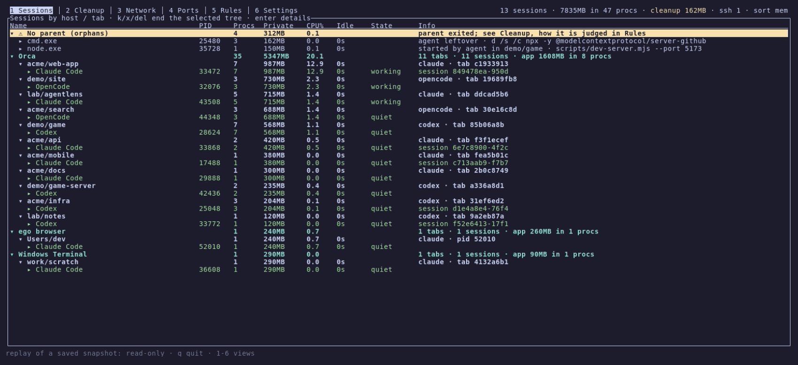

<h1 align="center">agentlens</h1>

<p align="center">
  <b>See every process your coding agents started, and safely end what they left behind.</b>
</p>

<p align="center">
  <a href="LICENSE"></a>
  
  
</p>

<p align="center"><b>English</b> | <a href="README.ko.md">한국어</a></p>

<p align="center">
  
</p>

## Why agentlens?

Coding agents start a lot of processes: MCP servers, REPLs, language servers, dev servers,
shells. Then:

- **They outlive their sessions.** Close a terminal tab or let an agent crash, and its MCP servers,
  dev servers and shells keep running. Some of them use hundreds of megabytes each, and they pile
  up over a day.
- **They all look alike.** Task Manager or `htop` shows 17 `node.exe` and 12 `node_repl.exe`. Which
  ones belong to the session you are working in?
- **Guessing is dangerous.** End the wrong `node` and you kill a live session in the middle of its
  work.

agentlens answers two questions about every process: **whose is it, and is its owner still
there?** It groups processes by *host → tab → agent session*, finds what ended sessions left
behind from evidence rather than names, and ends them only when it is safe to.

## Highlights

- **Knows whose process it is.** It builds a host → tab → session → process tree for 45 agents
  (Claude Code, Codex, opencode, Gemini CLI, Copilot CLI, Aider, Goose, …). Supported hosts include
  Orca, VS Code, Cursor, JetBrains, Windows Terminal, iTerm2, Ghostty, tmux, SSH logins and WSL.
- **Finds leftovers by evidence, not by name.** It records what it saw under a session (lineage). It
  reads the session and PID that agents write into everything they start (birth record), and on
  Windows it checks whether anyone can still talk to a stdio server. Every candidate shows the
  evidence, for example `owner-gone, from session Claude Code @ Orca / acme/web-app, agent-infra`.
- **Safe by design.**
  - It never ends hosts, system processes, its own terminal, or anything you `protect`.
  - It ends parents before children and re-checks each PID's start time right before ending it.
  - Confirmation takes an explicit `y`.
  - Apps with a window, and processes another live session is still using, are kept unless you
    ask otherwise.
- **Works with any host.** Judgments come from OS facts (process tree, start times, environment,
  sockets, pipes), never from one host app's internals.
- **Agents can tell you what they are doing.** Turn on agent hooks in Settings and Claude Code
  reports *waiting for input* and *needs you* (permission prompts). It never makes the agent wait.
- **Agents can ask it, too.** Register its MCP server from Settings, and an agent can list what
  ended sessions left behind and end it, under the same safety rules.
- **Featherweight and native.** It uses about 9 MB of memory and 1–3% of one core while idle. It is
  written in Rust and calls each OS's own kernel interfaces.
- **Data-driven.** Everything it knows about agents and hosts lives in
  [`catalog.toml`](crates/core/catalog.toml). Your `rules.toml` extends it in the same format.

## Screenshots

**Sessions**: what each agent runs, grouped by host and tab, with memory, CPU and state.



| Cleanup: candidates and their evidence | Ports: who listens where |
|---|---|
|  |  |
| **Network: SSH connections and keys** | **Settings: cleanup, safety, agent hooks** |
|  |  |

The screenshots replay a made-up snapshot (`--replay`), so no real machine is shown. The UI is
also available in Korean ([screenshot](docs/images/sessions-ko.png)).

## Installation

Download the archive for your platform from the
[latest release](https://github.com/IceMan0224/agentlens/releases/latest) (Windows x64, Linux x64,
macOS Apple silicon only), unpack it and run `agentlens`. On macOS, the first run of a
downloaded binary may need `xattr -d com.apple.quarantine agentlens`.

To build it yourself instead, you need [Rust](https://rustup.rs) 1.88 or newer:

```sh
cargo install --git https://github.com/IceMan0224/agentlens agentlens
```

Or build from source:

```sh
git clone https://github.com/IceMan0224/agentlens
cd agentlens
cargo build --release
./target/release/agentlens
```

## Usage

```sh
agentlens                          # interactive dashboard
agentlens --report                 # print the current state once
agentlens --dump-json > snap.json  # raw snapshot (secrets in command lines are masked)
agentlens --report snap.json       # classify a saved snapshot
agentlens --replay snap.json       # browse a saved snapshot in the dashboard, read-only
```

| View | Shows | Keys |
|---|---|---|
| 1 Sessions | Host › tab › session › process tree with memory, CPU, idle time and state | `←/→` fold, `enter` details, `k` end the selected tree, `h` register a host |
| 2 Cleanup | Cleanup candidates and the evidence for each (yellow = proposed) | `space` mark, `x` end marked |
| 3 Network | SSH connections, keys, known hosts | `d` disconnect |
| 4 Ports | Listening ports of sessions and leftovers | `k` end the owner, `a` all ports |
| 5 Rules | How leftovers are found, the agents and hosts on this PC (commands on `PATH`, app launchers: Start Menu, `.desktop`, `.app`, and whatever is running) and the rest of the catalog, rules file | `e` edit, `r` reload |
| 6 Settings | Language, automatic cleanup, idle threshold, leftovers to keep, agent hooks, agent MCP | `←/→`/`enter` change |

Common keys: `1`–`6` or `tab` switch views, `s` sort (memory, CPU, idle), mouse wheel and
clicks, `q` quit.

## How it works

Every second agentlens lists all processes through each OS's own interface
(`NtQuerySystemInformation` on Windows, `sysctl`/libproc on macOS, `/proc` on Linux) and builds a
tree. Agents, hosts, shells and runtimes are recognized from the catalog. Each agent process
without an agent ancestor roots a session. The nearest host above it, and the host's tab
variables, place it in a tab.

A process counts as a leftover in either of these cases:

- **Its parent is gone.** This includes a parent PID that was reused, and on Unix a process adopted
  by launchd or systemd.
- **The session that started it has ended.** This is found three ways:
  - *lineage*: the dashboard saw the process under that session;
  - *birth record*: the process carries `AI_AGENT`, `CLAUDE_CODE_SESSION_ID` or `CLAUDE_PID`, which
    agents set and children inherit;
  - *closed channel* (Windows only): nobody can write to the process's input pipe any more.

A leftover is proposed for cleanup 15 seconds after its owner is seen gone. The full rules are in
the Rules view and the [Korean documentation](README.ko.md).

A process that left a running session's tree, such as `nohup uv run python run.py`, is not a
leftover. It stays under that session as *detached*, and ending the session ends it too.

### Agent hooks

Switching on **Agent hooks** in Settings adds agentlens to the agent's own hook settings
(Claude Code: `~/.claude/settings.json`). Other hooks and settings are kept, and the file is backed
up first. The agent then runs agentlens in the background on session start, prompt, stop,
notification and session end; you never run anything yourself. Codex and Gemini CLI will follow
once their hook formats and background execution are confirmed.

### Agent MCP

Switch on **Agent MCP** for an agent in Settings, and you can ask the agent "are there leftovers?"
or "clean them up". Settings lists the agents used on this machine that take MCP servers
(Claude Code, Codex, Gemini CLI, Qwen Code, opencode, Cursor, Copilot CLI, Kiro, Droid, Amp, Kimi, CodeBuddy, Qoder, Auggie, Kilo Code and Rovo Dev). agentlens adds `agentlens mcp` to
the agent's user-level MCP settings, the same binary with nothing else to install. Other settings
are kept and the file is backed up first; Claude Code, which rewrites its file all the time, is
changed through its own `claude mcp add`.

| Tool | What it does |
|---|---|
| `list_leftovers` | Cleanup candidates, the evidence for each, and which are proposed |
| `list_session_processes` | The asking session's process tree, with memory, commands and listening ports |
| `end_leftovers` | Ends the proposed candidates, or those named by pid. Nothing outside the candidate list, and never the asking session |

The server only passes questions on. The dashboard, which has watched the sessions, decides and
ends, with the same refusals and re-checks as when you end something yourself, so keep it
running; without it the tools say so. They talk through small files in agentlens's state folder
(`%LOCALAPPDATA%\agentlens\requests`, `~/.local/state/agentlens/requests`), so no port is opened.
The agent still asks you before ending anything unless you allow the tool.

## Configuration

Rules live in `%APPDATA%\agentlens\rules.toml` on Windows and
`$XDG_CONFIG_HOME/agentlens/rules.toml` (default `~/.config/agentlens/rules.toml`) elsewhere.
They use the same tables as the catalog and extend it.

```toml
idle_minutes = 30
protect = ["dev-server"]          # never end processes whose name or command line contains this
language = "en"                   # en | ko
auto_cleanup_minutes = 0          # 0 = off
end_windowed = false              # also propose leftovers with a window
end_shared = false                # also propose leftovers a live session uses

[[agents]]                        # an agent the catalog does not know
id = "myagent"
exe = ["myagent"]

[[hosts]]                         # a terminal or IDE the catalog does not know
id = "myterm"
exe = ["myterm"]
tab_env = "MYTERM_TAB"
```

## Limitations

- Disconnecting SSH ends the owning process; it does not drop the TCP connection alone.
- Processes of other users and services cannot be read and are not classified.
- The closed-channel check is Windows-only for now: on macOS and Linux, Node-started MCP servers
  talk over socket pairs rather than pipes.

## Development

```sh
cargo test --workspace
cargo clippy --workspace --all-targets
```

Tests include a realistic made-up snapshot, macOS/Linux-shaped process trees, leftover detection
over time, and live tests that start, find and end real processes on each OS.

The screenshots and the animation are recorded with [VHS](https://github.com/charmbracelet/vhs)
from the tapes in [`docs/demo`](docs/demo), which replay the made-up snapshot. Run
`cargo build --release` first, then `vhs docs/demo/demo.tape`.

Contributions are welcome. For a new agent or host, an entry in
[`catalog.toml`](crates/core/catalog.toml) is usually all it takes. Please open an issue first for
larger changes.

## License

[MIT](LICENSE)
