<h1 align="center">agentlens</h1>

<p align="center">
  <b>找出 Claude Code、Codex 等编码智能体启动后遗忘的进程，凭证据说明它属于哪个会话，并安全地清理掉。</b>
</p>

<p align="center">
  <a href="LICENSE"></a>
  
  
</p>

<p align="center">
  <a href="README.md">English</a> · <a href="README.ko.md">한국어</a> · <a href="README.ja.md">日本語</a> · <b>简体中文</b>
</p>

<p align="center">
  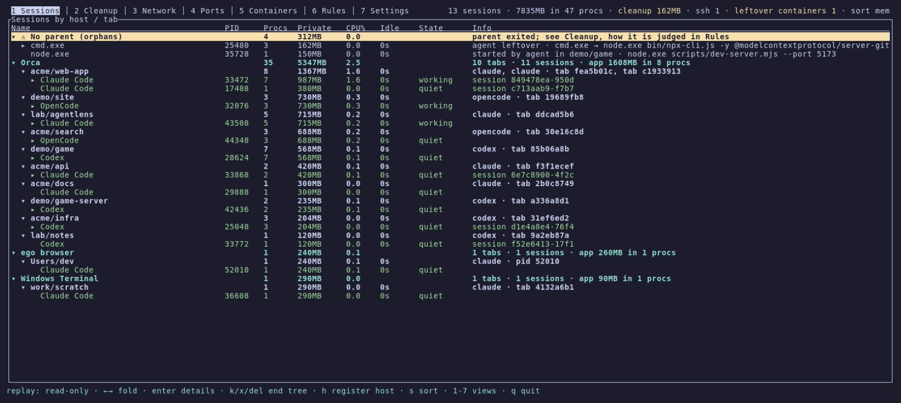
</p>

## 为什么需要 agentlens？

编码智能体会启动大量进程：MCP 服务器、REPL、语言服务器、开发服务器、shell。然后：

- **会话结束了，它们还在。** 关掉终端标签页或智能体崩溃后，它的 MCP 服务器、开发服务器和 shell 仍在运行。
  有的每个占用几百 MB，一天下来越积越多。
- **它们看起来都一样。** 任务管理器或 `htop` 里有 17 个 `node.exe` 和 12 个 `node_repl.exe`。哪些属于你正在用的会话？
- **靠猜很危险。** 结束错一个 `node`，就会让正在工作的会话中途死掉。

agentlens 对每个进程回答两个问题：**它是谁的？它的主人还在吗？** 它按 *宿主 → 标签页 → 智能体会话* 给进程分组，
根据证据而不是名字找出已结束会话遗留的进程，并且只在安全时才结束它们。

## 亮点

- **知道进程属于谁。** 为 [45 种智能体](#支持的智能体与宿主)（Claude Code、Codex、opencode、Gemini CLI、Copilot CLI、
  Aider、Goose 等）构建 宿主 → 标签页 → 会话 → 进程 的树。支持的宿主包括 Orca、Paseo、VS Code、Cursor、JetBrains、
  Windows Terminal、iTerm2、Ghostty、cmux、tmux、herdr、SSH 登录和 WSL。
- **凭证据而不是名字找出遗留进程。** 它记录在会话下看到过的进程（谱系）；读取智能体写入其启动的所有进程中的会话和 PID
  （出生记录）；在 Windows 上还会检查是否还有人能与 stdio 服务器通信。每个候选都会显示依据，例如
  `owner-gone, from session Claude Code @ Orca / acme/web-app, agent-infra`。
- **默认安全。**
  - 绝不结束宿主、系统进程、它自己所在的终端，以及你 `protect` 的任何进程。
  - 先结束父进程再结束子进程，并在结束前一刻重新核对每个 PID 的启动时间。
  - 确认必须明确按 `y`。
  - 带窗口的应用，以及其他活动会话仍在使用的进程，除非你另行设置，否则会保留。
- **适用于任何宿主。** 判断只依据操作系统事实（进程树、启动时间、环境变量、套接字、管道），从不依赖某个宿主应用的内部信息。
- **智能体可以告诉你它在做什么。** 在设置中开启智能体钩子后，Claude Code 会报告 *等待输入* 和 *需要你处理*（权限请求）。
  它从不让智能体等待。
- **智能体也可以来问它。** 在设置中注册它的 MCP 服务器后，智能体可以列出已结束会话遗留的进程，并按同样的安全规则结束它们。
- **轻量、原生。** 空闲时约占 9 MB 内存、单核 1–3% 的 CPU。用 Rust 编写，直接调用各操作系统自己的内核接口。
- **数据驱动。** 关于智能体和宿主的所有知识都在 [`catalog.toml`](crates/core/catalog.toml) 中，你的 `rules.toml`
  以相同格式扩展它。

## 截图

**Sessions**：每个智能体在运行什么，按宿主和标签页分组，附带内存、CPU 和状态。CPU% 以整台机器为 100 计算，
底部一行列出当前视图的按键。

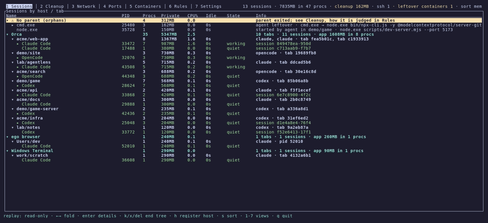

| Cleanup：候选及其依据 | Ports：谁在哪里监听 |
|---|---|
| 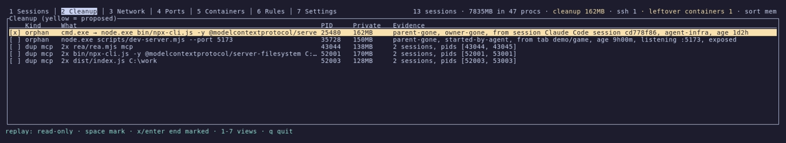 | 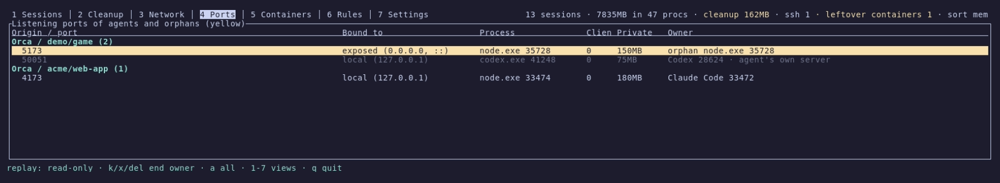 |
| **Network：SSH 连接和密钥** | **Settings：清理、安全、智能体钩子** |
| 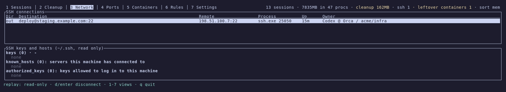 | 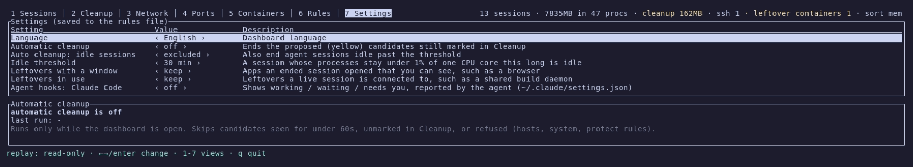 |

截图回放的是虚构的快照（`--replay`），不包含任何真实机器的信息。界面语言为英语和韩语。

## 支持的智能体与宿主

agentlens 通过命令名识别以下 45 种智能体，包括通过 npm 安装、以 `node` 运行的智能体。**粗体** 标出的智能体可以在设置中
注册 agentlens 的 MCP 服务器；智能体钩子目前只支持 Claude Code。

| 智能体 | 命令 | 智能体 | 命令 | 智能体 | 命令 |
|---|---|---|---|---|---|
|  **Claude Code** | `claude` |  Claude Agent Teams | 由 Orca 启动 |  **CodeBuddy** | `codebuddy` |
|  OpenClaude | `openclaude` |  **Codex** | `codex` |  Autohand | `autohand` |
|  Ante | `ante` |  Trae CLI | `traecli` |  **OpenCode** | `opencode` |
|  OpenCode 2 | `opencode2` |  MiMo Code | `mimo` | 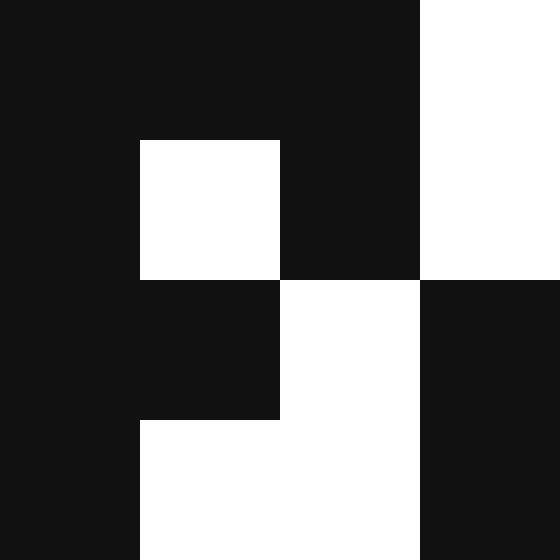 Pi | `pi` |
|  OMP | `omp` |  Prime Agent | `prime-agent` |  **Qoder** | `qodercli` |
|  Qoder CN | `qoderclicn` |  **Gemini CLI** | `gemini` |  Antigravity CLI | `agy` |
|  Aider | `aider` |  Goose | `goose` |  **Amp** | `amp` |
|  **Kilo Code** | `kilo` |  **Kiro CLI** | `kiro-cli` |  Crush | `crush` |
|  **Auggie** | `auggie` |  Cline | `cline` |  Freebuff | `freebuff` |
|  Codebuff | `codebuff` |  Command Code | `command-code` |  Continue | `cn` |
|  **Cursor Agent** | `cursor-agent` |  **Droid** | `droid` |  **Kimi** | `kimi` |
|  Mistral Vibe | `vibe` |  **Qwen Code** | `qwen` |  **Rovo Dev** | `acli` |
|  Hermes | `hermes` |  OpenClaw | `openclaw` |  **GitHub Copilot CLI** | `copilot` |
|  Grok CLI | `grok` |  Muse | `muse` |  DSH | `dsh-tui` |
|  ZCode | `zcode` |  Devin | `devin` |  JCode | `jcode` |

图标归各项目所有，智能体图标大部分取自 [Orca](https://github.com/stablyai/orca)。

宿主是智能体运行所在的程序。VS Code、Cursor 和 Windsurf 也包括它们的远程服务器（Remote-SSH、WSL）和 code-server。

| 宿主 | 进程 | 宿主 | 进程 | 宿主 | 进程 |
|---|---|---|---|---|---|
|  Orca | `orca` |  Paseo | `Paseo`, `Paseo Daemon` (`node`) |  Claude Desktop | `Claude.app`, `AnthropicClaude` |
|  VS Code | `code` |  Cursor | `cursor` |  Windsurf | `windsurf` |
|  Kiro | `kiro` |  Antigravity | `antigravity` |  Trae | `trae` |
|  Zed | `zed` |  JetBrains IDEs | `idea64`, `pycharm64`, … |  Windows Terminal | `WindowsTerminal` |
|  Terminal (macOS) | `Terminal.app` |  iTerm2 | `iTerm.app` |  Ghostty | `ghostty` |
|  kitty | `kitty` |  WezTerm | `wezterm-gui` |  Alacritty | `alacritty` |
|  Warp | `warp` |  Wave | `wave` |  Tabby | `tabby` |
|  cmux | `cmux` |  GNOME Terminal | `gnome-terminal-server` |  Konsole | `konsole` |
| 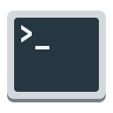 Xfce Terminal | `xfce4-terminal` | 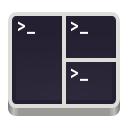 Tilix | `tilix` |  Terminator | `terminator` |
|  xterm | `xterm` | 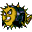 SSH 登录 | `sshd`, `sshd-session` |  WSL | `SessionLeader` |
| 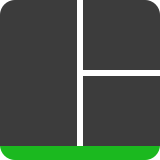 tmux | `tmux` | 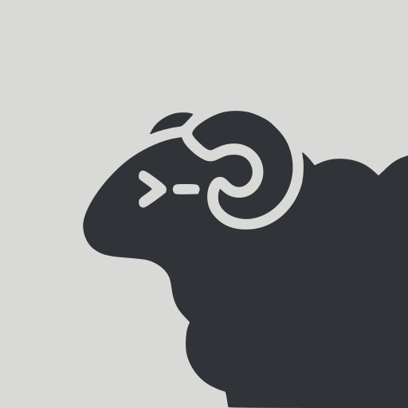 herdr | `herdr` |  screen | `screen` |
|  ego browser | `ego` |   |   |   |   |

为每个标签页设置变量的宿主按该变量划分标签页：Orca（`ORCA_TAB_ID`，每个 worktree 一行）、Paseo（`PASEO_TERMINAL_ID`；Paseo 自己启动的智能体各占一个标签页）、Windows Terminal
（`WT_SESSION`）和 cmux（`CMUX_WORKSPACE_ID`，每个 workspace 一个标签页）。每个 SSH 登录、每个 tmux、herdr 或 screen
窗格都是一个标签页。不在此列表中的程序启动智能体时会显示为 "(unregistered)"，在 Sessions 中按 `h` 即可把它加入规则。

## 安装

从[最新发布](https://github.com/IceMan0224/agentlens/releases/latest)下载对应平台的压缩包（Windows x64、Linux x64、
macOS 仅限 Apple 芯片），解压后运行 `agentlens`。在 macOS 上首次运行下载的二进制文件时，可能需要执行
`xattr -d com.apple.quarantine agentlens`。

如果要自己构建，需要 [Rust](https://rustup.rs) 1.88 或更高版本：

```sh
cargo install --git https://github.com/IceMan0224/agentlens agentlens
```

或者从源码构建：

```sh
git clone https://github.com/IceMan0224/agentlens
cd agentlens
cargo build --release
./target/release/agentlens
```

## 用法

```sh
agentlens                          # 交互式仪表盘
agentlens --report                 # 打印一次当前状态
agentlens --dump-json > snap.json  # 原始快照（命令行中的密钥会被遮盖）
agentlens --report snap.json       # 对保存的快照进行分类
agentlens --replay snap.json       # 在仪表盘中只读浏览保存的快照
agentlens locks <path>             # 按智能体会话列出占用某个文件或文件夹的进程
```

当更新或删除因 `EBUSY`、"resource busy or locked" 或 "另一个程序正在使用此文件" 失败时，`agentlens locks` 会列出
运行该路径下可执行文件的进程、以其中目录为工作目录的进程，以及（Windows）打开了其中任何内容的进程。它们按智能体会话分组，
遗留进程会标出依据：

```text
3 process(es) hold C:\Users\me\AppData\Roaming\npm\node_modules\@openai\codex:
- Codex @ Orca / acme/web-app (pid 28624)
  - pid 12040 codex.exe: runs node_modules\@openai\codex-win32-x64\...\bin\codex.exe
  - pid 39448 codex-code-mode-host.exe: runs node_modules\@openai\...\bin\codex-code-mode-host.exe
- leftover node.exe watcher.js (pid 25480): proposed, owner-gone, from session Codex @ Orca / acme/api
  - pid 25480 node.exe: has node_modules\@openai\codex\package.json open
```

| 视图 | 显示内容 | 按键 |
|---|---|---|
| 1 Sessions | 宿主 › 标签页 › 会话 › 进程树，附内存、CPU、空闲时间和状态 | `←/→` 折叠，`enter` 详情，`k` 结束所选的树，`h` 注册宿主 |
| 2 Cleanup | 清理候选及各自的依据（黄色 = 建议清理） | `space` 标记，`x` 结束已标记的 |
| 3 Network | SSH 连接、密钥、known hosts | `d` 断开 |
| 4 Ports | 会话和遗留进程的监听端口 | `k` 结束其所有者，`a` 所有端口 |
| 5 Rules | 遗留进程的判定方式、本机上的智能体和宿主（`PATH` 上的命令、应用启动器：开始菜单、`.desktop`、`.app`，以及正在运行的程序）和其余目录项、规则文件 | `e` 编辑，`r` 重新加载 |
| 6 Settings | 语言、自动清理、空闲阈值、要保留的遗留进程、智能体钩子、智能体 MCP | `←/→`/`enter` 更改 |

通用按键：`1`–`6` 或 `tab` 切换视图，`s` 排序（内存、CPU、空闲），支持鼠标滚轮和点击，`q` 退出。

## 工作原理

agentlens 每秒通过各操作系统自己的接口（Windows 上是 `NtQuerySystemInformation`，macOS 上是 `sysctl`/libproc，
Linux 上是 `/proc`）列出所有进程并构建进程树。智能体、宿主、shell 和运行时通过目录（catalog）识别。每个没有智能体祖先的
智能体进程都是一个会话的根。它上方最近的宿主，以及该宿主的标签页变量，决定它属于哪个标签页。同一 worktree 的 Orca
标签页共用一行。

满足以下任一情况的进程视为遗留进程：

- **它的父进程不在了。** 包括父 PID 被复用，以及在 Unix 上被 launchd 或 systemd 收养的进程。
- **启动它的会话已经结束。** 通过三种方式发现：
  - *谱系*：仪表盘曾在该会话下看到过这个进程；
  - *出生记录*：进程带有 `AI_AGENT`、`CLAUDE_CODE_SESSION_ID` 或 `CLAUDE_PID`，这些由智能体设置并被子进程继承；
  - *通道关闭*（仅 Windows）：已经没有人能向该进程的输入管道写入。

在发现所有者消失 15 秒后，遗留进程才会被建议清理。完整规则见 Rules 视图和[韩语文档](README.ko.md)。

离开了运行中会话进程树的进程（例如 `nohup uv run python run.py`）不是遗留进程。它会以 *detached* 的形式留在该会话下，
结束该会话时也会一并结束。

### 智能体钩子

在设置中开启 **Agent hooks** 后，agentlens 会被加入智能体自己的钩子设置（Claude Code：`~/.claude/settings.json`）。
其他钩子和设置保持不变，并会先备份文件。此后智能体会在会话开始、提交提示、停止、通知和会话结束时在后台运行 agentlens，
你不需要自己运行任何东西。Codex 和 Gemini CLI 将在确认其钩子格式和后台执行方式后跟进。

### 智能体 MCP

在设置中为某个智能体开启 **Agent MCP** 后，你可以问智能体"有遗留进程吗？"或者"清理一下"。设置中会列出本机使用的、
支持 MCP 服务器的智能体（Claude Code、Codex、Gemini CLI、Qwen Code、opencode、Cursor、Copilot CLI、Kiro、Droid、Amp、
Kimi、CodeBuddy、Qoder、Auggie、Kilo Code 和 Rovo Dev）。agentlens 会把 `agentlens mcp` 加入智能体的用户级 MCP 设置，
用的是同一个二进制文件，无需额外安装。其他设置保持不变，并会先备份文件；Claude Code 会频繁重写自己的文件，因此通过它自己的
`claude mcp add` 来修改。

| 工具 | 作用 |
|---|---|
| `list_leftovers` | 清理候选、各自的依据，以及哪些被建议清理 |
| `list_session_processes` | 提问会话的进程树，附内存、命令和监听端口 |
| `end_leftovers` | 结束被建议的候选，或按 pid 指定的候选。不会结束候选列表之外的进程，也绝不结束提问的会话 |
| `find_lock_holders` | 谁占用了某个文件或文件夹（与 `agentlens locks` 显示的一样），让更新或删除失败的智能体知道该关闭哪个会话 |

MCP 服务器只负责转发问题。判断和结束由一直在观察会话的仪表盘完成，拒绝规则和重新核对与你亲自结束时相同，因此请保持仪表盘运行；
没有仪表盘时，工具会如实告知。两者通过 agentlens 状态文件夹中的小文件通信（`%LOCALAPPDATA%\agentlens\requests`、
`~/.local/state/agentlens/requests`），因此不会打开任何端口。除非你允许了该工具，智能体在结束任何进程前仍会先询问你。

## 配置

规则在 Windows 上位于 `%APPDATA%\agentlens\rules.toml`，其他系统位于 `$XDG_CONFIG_HOME/agentlens/rules.toml`
（默认 `~/.config/agentlens/rules.toml`）。它们使用与目录相同的表结构，用来扩展目录。

```toml
idle_minutes = 30
protect = ["dev-server"]          # 名称或命令行包含此内容的进程永不结束
language = "en"                   # en | ko
auto_cleanup_minutes = 0          # 0 = 关闭
end_windowed = false              # 也建议清理带窗口的遗留进程
end_shared = false                # 也建议清理活动会话正在使用的遗留进程

[[agents]]                        # 目录中没有的智能体
id = "myagent"
exe = ["myagent"]

[[hosts]]                         # 目录中没有的终端或 IDE
id = "myterm"
exe = ["myterm"]
tab_env = "MYTERM_TAB"
```

## 限制

- 断开 SSH 的方式是结束持有该连接的进程，不会单独断开 TCP 连接。
- 无法读取其他用户和服务的进程，因此不对其分类。
- 只在 Windows 上查找打开的文件（在 Windows 上，打开的文件会阻止替换或删除）。在其他系统上，`locks` 报告正在运行的
  可执行文件和工作目录。在 Windows 上，它会读取所有可打开进程的文件句柄（约半秒），看不到其他用户的进程。
- 通道关闭检查目前仅支持 Windows：在 macOS 和 Linux 上，由 Node 启动的 MCP 服务器通过套接字对而不是管道通信。

## 开发

```sh
cargo test --workspace
cargo clippy --workspace --all-targets
```

测试包括一个贴近真实的虚构快照、macOS/Linux 形态的进程树、随时间推移的遗留进程检测，以及在各操作系统上启动、发现并结束
真实进程的实机测试。

截图和动画使用 [VHS](https://github.com/charmbracelet/vhs) 根据 [`docs/demo`](docs/demo) 中的脚本录制，回放的是虚构快照。
先运行 `cargo build --release`，再运行 `vhs docs/demo/demo.tape`。

欢迎贡献。新增智能体或宿主通常只需在 [`catalog.toml`](crates/core/catalog.toml) 中添加一项。较大的改动请先开 issue 讨论。

## 许可证

[MIT](LICENSE)
